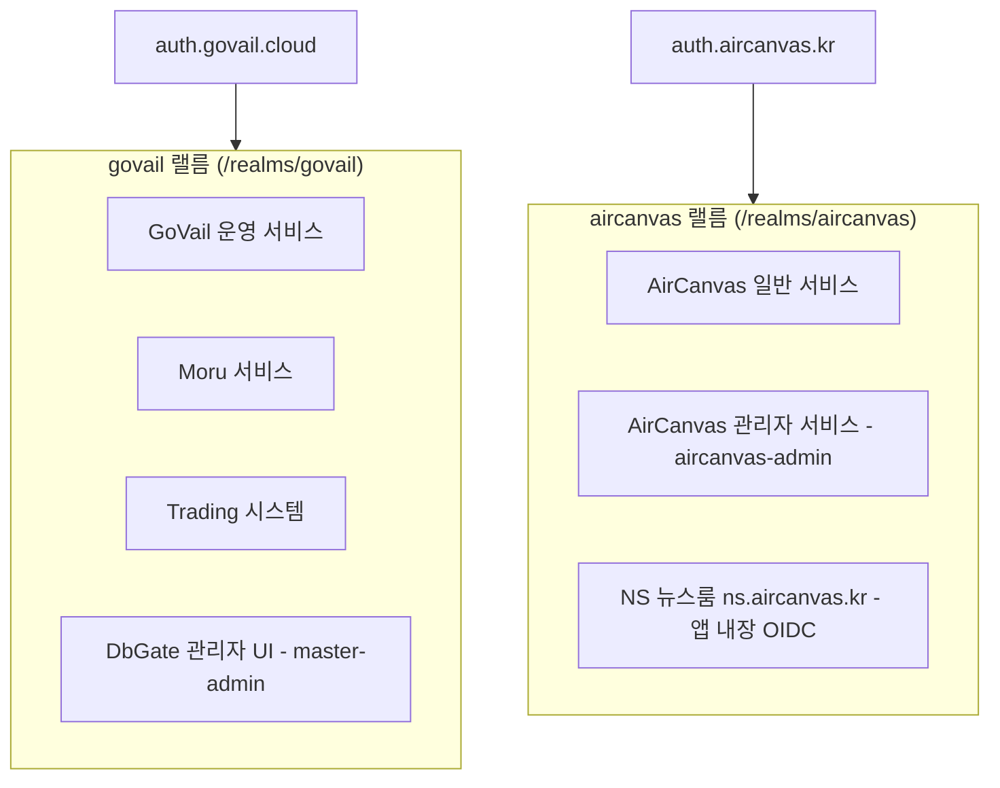

# Keycloak OIDC/SSO 중앙 인증 운영 스킬 (keycloak)

이 스킬은 `platform-edge-infra` 환경에서 Keycloak을 통한 중앙 인증(SSO), OpenID Connect(OIDC) 공급자 관리, 랠름(Realm) 분리, OAuth2-Proxy 연동, 앱 내장 OIDC 및 역할 기반 접근 제어(RBAC)를 안전하게 운영하기 위한 표준 지침입니다.

---

## 1. 아키텍처 및 공개 진입점 표준

- **Keycloak은 1개 인스턴스 + 1개 DB**입니다. 별도 서비스·DB로 나누지 않고, **랠름마다 공개 주소(realm `frontendUrl`)를 달리해** 발급자(Issuer)를 분리합니다.
- **랠름별 Issuer (정본)**:

  | 랠름 | Issuer | 대상 |
  | --- | --- | --- |
  | `govail` | `https://auth.govail.cloud/realms/govail` | `*.govail.cloud`, `moru.my` 등 사내 플랫폼 |
  | `aircanvas` | `https://auth.aircanvas.kr/realms/aircanvas` | `*.aircanvas.kr` 고객 대상 서비스, NS 뉴스룸 |

  - `govail`은 `KC_HOSTNAME`(`auth.govail.cloud`) 기본값을 쓰고, `aircanvas`는 realm 속성 `frontendUrl=https://auth.aircanvas.kr`로 분리합니다.
  - `auth.aircanvas.kr`은 `/realms/aircanvas`, `/resources`, `/js`만 서빙하고 그 밖의 경로(master·govail 랠름, 관리 콘솔)는 `auth.govail.cloud`로 301 이동합니다(`nginx/config/conf.d/auth.conf`).
  - `auth.govail.cloud`에서도 `/realms/aircanvas`가 응답하지만 **Issuer는 `auth.aircanvas.kr`로 광고**됩니다. aircanvas 클라이언트·프록시 설정은 항상 `auth.aircanvas.kr` 기준으로 씁니다.
  - **Issuer는 디스커버리 문서(`/.well-known/openid-configuration`)의 `issuer`와 글자까지 같아야 합니다.** 다르면 토큰 검증이 실패합니다.
  - `aircanvas` 랠름의 `frontendUrl`을 바꾸려면 Google 로그인(Identity Broker)의 OAuth 리디렉션 URI와 모든 aircanvas 클라이언트의 issuer 설정을 함께 바꿔야 합니다. 토큰의 `iss`가 이 값이기 때문입니다.
- **백엔드 DB**: `ai-data-infra`의 `shared-postgres` (`db-server:5432`) 내 `keycloak` 데이터베이스와 연동.

---

## 2. 랠름(Realm) 분리 및 신뢰 경계

Keycloak은 서비스 도메인과 보안 요구사항에 따라 랠름을 엄격히 분리하여 운영합니다. 계정과 Google Identity Broker 설정은 랠름 단위로 독립이며, 랠름 간 계정 이동은 명시적 마이그레이션과 역할 재부여가 필요합니다.



- **`govail` 랠름**: 사내 플랫폼 및 내부 운영 서비스 전용.
  - 관리자 전용 서비스(예: `dbgate.govail.cloud`)는 `master-admin` 역할을 필수 요구.
- **`aircanvas` 랠름**: 고객 대상 서비스 전용.
  - 각 realm은 OAuth2-Proxy와 OIDC client를 하나씩 사용한다. 일반·관리자 라우트는 realm 쿠키를 공유하고, 관리자 권한은 Nginx 내부 `auth_request`의 `allowed_groups=role:<realm-role>` 조건으로 검사한다.
  - 로그인 수단은 Google Identity Broker뿐이며, 첫 로그인 계정은 `users`만 받습니다.
  - 그룹은 권한 단위입니다: `aircanvas-admins`(→ `aircanvas-admin` 역할), `users`(→ `users` 역할), `admin-master`(**역할 없음**, 뉴스룸 관리자 전용 식별 그룹).

---

## 3. OAuth2-Proxy 및 라우트 연동 규격

외부 트래픽은 Nginx의 `auth_request` 모듈과 OAuth2-Proxy를 통해 Keycloak과 연동됩니다.

1. **인증 정책 (`edge.auth`)**:
   - `public`: 인증 불필요 (Keycloak 클라이언트 미생성)
   - `login`: 일반 OIDC 인증 (로그인된 모든 유저 허용)
   - `admin`: 공용 realm OAuth2-Proxy 로그인 후 해당 라우트의 관리자 역할 보유 필수 (예: `govail`의 `role:master-admin`)
   - `app`: 서비스 애플리케이션이 직접 OIDC를 처리하고 토큰을 검증 (아래 §3.1)
2. **세션 및 콜백 보존**:
   - OAuth2 콜백 쿼리(`code`, `state`)와 세션 쿠키 범위를 정확히 유지.
   - Redirect URI에는 반드시 명시적인 허용 목록(Allowlist)을 적용.
   - 공통 OAuth2-Proxy 쿠키 정책은 30분마다 갱신, 최대 24시간이다. 역할별 만료 정책을 두지 않는다.
  - Nginx `/oauth2/auth`는 기본 인증에 사용하고, `admin` 경로는 내부 요청에만 `allowed_groups=role%3A<role>`을 붙여 검사한다. 인증 안 된 요청은 401로 로그인시키고, 역할이 없는 로그인 세션은 계속 차단한다. 브라우저 HTML 요청은 GoVail 또는 AirCanvas realm의 `/access-denied` 페이지로 보내고 API는 403을 유지한다.

### 3.1 앱 내장 OIDC 패턴 (`app`) — 예: NS 뉴스룸

일반 회원 로그인은 막지 않고 관리자 화면만 제한하는 서비스는 oauth2-proxy 없이 앱이 직접 인가 코드 흐름을 처리합니다. 기준 구현은 `/srv/products/newsroom`(`packages/core/src/auth/oidc.ts`, `apps/web/proxy.ts`)입니다.

- **클라이언트 규격**: confidential, 인가 코드 + **PKCE S256**, `directAccessGrants`/`implicit` 끔, `fullScopeAllowed=false`, 리다이렉트 URI는 **정본 주소 하나**(`https://<정본>/auth/callback`), 로그아웃 복귀 URI(`post.logout.redirect.uris`)도 정본만. `groups` 그룹 멤버십 매퍼(전체 경로)를 ID 토큰에 싣습니다.
- **권한은 두 단계**: ① 로그인 — 이메일이 있는 랠름 계정이면 누구나(일반 회원, DB 저장 없이 서명 쿠키 세션) ② 관리자 — **그룹(`/admin-master`) AND 앱의 허용 이메일 목록**을 모두 만족하는 계정만. 그룹에 잘못 추가된 계정이 있어도 허용 목록이 한 번 더 막습니다.
- **그룹에는 역할을 붙이지 않습니다.** 다른 서비스 권한이 따라가지 않게 하기 위함입니다. 플랫폼 공용 역할(`master-admin` 등)을 앱 권한으로 재사용하지 않습니다.
- **ID 토큰 검증**: RS256만 허용하고 서명(JWKS)·`iss`·`aud`/`azp`·`exp`·`nonce`를 확인합니다. `state` 불일치·`nonce` 불일치는 거부합니다. 관리자 판정에는 `email_verified=true`를 요구하지만 일반 회원 로그인은 요구하지 않습니다.
- **Keycloak 쪽 설정은 손으로 만지지 않고 멱등 스크립트로 맞춥니다**(뉴스룸: `scripts/keycloak-sync.mjs`). `--dry-run`으로 계획 확인 → 적용 → 검증 순서이며, 그룹 구성원을 허용 목록과 정확히 일치시키고(그 밖의 구성원 제거), 클라이언트 비밀은 앱 `.env`에만 기록하고 출력하지 않습니다. 클라이언트 이름 변경은 삭제하지 않고 `clientId`만 바꿔 비밀을 유지합니다.
- **도메인을 바꾸면** 앱의 `SITE_URL`을 바꾼 뒤 동기화 스크립트를 다시 실행해 리다이렉트 URI·웹 오리진·로그아웃 URI를 새 정본으로 교체합니다.
- **검증(로그인 UI 없이 확인하는 방법)**:
  - `GET /clients/{id}/evaluate-scopes/generate-example-id-token?scope=openid email profile&userId=<id>`로 허용 계정의 토큰에 `groups`가 실리는지, 다른 계정에는 실리지 않는지 확인합니다.
  - 가짜 코드로 토큰 엔드포인트를 호출해 클라이언트 인증을 점검합니다: `invalid_grant`(400)면 클라이언트 인증 통과, `unauthorized_client`(401)면 비밀·클라이언트 오류입니다.
  - 인가 요청 URL을 열었을 때 `Invalid parameter: redirect_uri`가 아니라 로그인 화면이 떠야 합니다.

---

## 4. 서비스 라이프사이클 및 장애 격리

Keycloak이나 인증 관련 프록시 변경 시, **전체 서비스 스택을 재기동하지 않고 개별 컨테이너만 독립 기동**합니다.

```bash
# Keycloak 단독 기동 / 갱신
./scripts/edge-service-up.sh keycloak

# OAuth2-Proxy 단독 기동 / 갱신
./scripts/edge-service-up.sh oauth2-proxy
```

- Nginx 재기동 없이 OAuth2-Proxy와 Keycloak의 컨테이너를 독립적으로 업그레이드할 수 있습니다.

---

## 5. 불변 보안 원칙 (Safety & Security)

1. **시크릿 보호**:
   - Keycloak Client Secret, Cookie Secret, Admin 패스워드는 코드, 로그, 문서에 기록하지 않습니다.
   - 호스트 환경변수(`.env`) 및 Secret 주입을 통해서만 공급합니다.
2. **인증 실패 우회 금지**:
   - 401 Unauthorized / 403 Forbidden 상태를 2xx 성공으로 속이거나 임의로 우회하지 않습니다. 브라우저 403을 사용자 안내 페이지로 보낼 때도 권한 검사는 계속 fail-closed로 유지하고 API의 403은 그대로 반환합니다.
   - 설정이 덜 된 인증은 열린 쪽이 아니라 **닫힌 쪽(503)으로 실패**시킵니다.
3. **Realm 설정 형상 관리**:
   - 랠름 정의는 `keycloak/realm/*.json`에 보관하며, 변경 사항은 선언적으로 관리합니다. 라이브 랠름에 JSON을 통째로 import하지 않고 Admin API(또는 멱등 스크립트)로 적용합니다.
   - 클라이언트 조각을 바꾼 뒤에는 라이브 클라이언트도 Admin API로 갱신해야 합니다(JSON만 고치면 반영되지 않음).
4. **개인정보**:
   - 계정 이메일을 코드·문서·로그에 원문으로 남기지 않습니다(허용 목록은 앱 `.env`, 로그는 짧은 해시).
