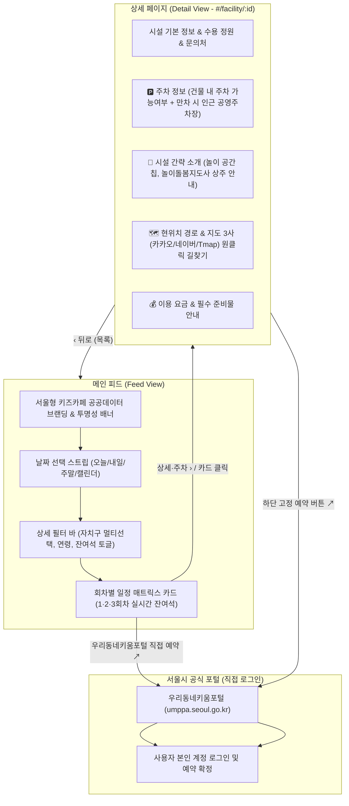

# S-Kids 데모 UI 아키텍처

## 방향 및 핵심 원칙

S-Kids는 **"서울형 키즈카페" 공공데이터 기반 실시간 예약 일정 비교 및 공식 예약 연계 대시보드**입니다.
불필요한 설문식 뎁스를 배제하고, 사용자가 접속하자마자 **한눈에 날짜별·회차별 잔여석 일정을 비교**한 뒤,
상세 페이지에서 **주차 정보, 시설 소개, 현위치 기준 경로 및 지도 앱 연동**을 확인하고,
**서울시 우리동네키움포털에서 본인 계정으로 직접 로그인하여 안전하게 예약**할 수 있는 클린 UI/UX를 제공합니다.



## 화면 구조

```text
1. 메인 피드 뷰 (Feed View)
  ├─ 공공데이터 & 브랜드 헤더 (서울시 공공데이터 뱃지 + 담은 시설)
  ├─ 투명성 공지 배너 (공공데이터 출처 & 본인 계정 직접 로그인 3단계 절차)
  ├─ 날짜 선택 캘린더 스트립 (오늘/내일/요일별 빠른 칩 + 직접 날짜 선택)
  ├─ 빠른 필터 바 (클린 바텀시트 모달 연동)
  │    ├─ [📍 자치구] (서울 전체 / 25개 자치구 멀티 선택 모달)
  │    ├─ [👶 연령] 아이 출생연도(연생) 선택 모달 (2026~2019년생 연생별 매핑)
  │    ├─ [⏱️ 시간] 희망 방문 시간/회차 선택 모달 (1회차 10시 / 2회차 13시 / 3회차 15:30)
  │    └─ [신청가능만 보기] 토글 스위치
  ├─ 회차별 일정 현황 카드 리스트
  │    ├─ 지점명, 자치구 태그, 연령 태그, 주차 가능 여부 미니 뱃지
  │    ├─ [1회차 10:00] [2회차 13:00] [3회차 15:30] 타임슬롯 매트릭스
  │    ├─ [우리동네키움포털 직접 예약 ↗] (메인 예약 액션)
  │    ├─ [상세·주차 ›] (상세 페이지 이동 버튼)
  │    └─ [🔄 새로고침] & [☆ 관심 등록]
  └─ 하단 공식 출처 및 법적 고지 푸터

2. 상세 페이지 뷰 (Detail View - SPA 라우팅 #/facility/:id)
  ├─ 상단 네비게이션 헤더 (‹ 뒤로가기, 지점명, ★ 찜하기, 🔗 공유하기)
  ├─ 히어로 요약 카드 (지점명, 자치구, 연령, 정원, 문의전화, 한 줄 소개)
  ├─ 당일 회차별 예약 현황 & 서울시 공식 예약 바로가기 CTA
  ├─ 🅿️ 주차 안내 (건물 내 주차장 형태, 지원 요금/시간, 만차 시 인근 공영주차장 추천)
  ├─ 🗺️ 현위치 경로 및 오시는 길
  │    ├─ 주소 및 [주소 복사] 버튼
  │    ├─ 내 위치 기반 직선거리 및 소요시간 확인
  │    ├─ 지도 앱 3사 원클릭 연동 (🟡 카카오맵, 🟢 네이버 지도, 🔴 Tmap)
  │    └─ 대중교통 상세 안내 (지하철역 출구/도보분수, 버스 노선, 진입 팁)
  ├─ 🧸 시설 간략 소개 & 놀이 편의 시설 (놀이존 칩 그리드, 돌봄 인력 안내)
  ├─ 💰 이용 요금 & 이용 안내 (아동/보호자 요금, 감면 조건, 미끄럼방지 양말 등)
  └─ 하단 고정 예약 바 (전화문의 📞 + 우리동네키움포털 직접 예약 ↗)
```

## 데이터 및 보안 원칙

1. **공공데이터 직결**: 서울 열린데이터광장(OA-21716) 시설 스키마 및 공식 예약 시스템 데이터 연계.
2. **비로그인 정보 제공**: S-Kids는 사용자 계정 정보를 요구하지 않으며 안전하게 브라우저 로컬스토리지에 관심 시설만 보관.
3. **직접 예약 동선**: 실제 예약은 지점별 `q_fcltyId`가 부여된 공식 포털 페이지로 연결되어 사용자가 직접 수행.
4. **모바일 퍼스트 UX**: 모바일 최적화 레이아웃(640px Max 컨테이너), 부드러운 화면 전환, URL 해시를 통한 브라우저 뒤로가기 완벽 지원.
