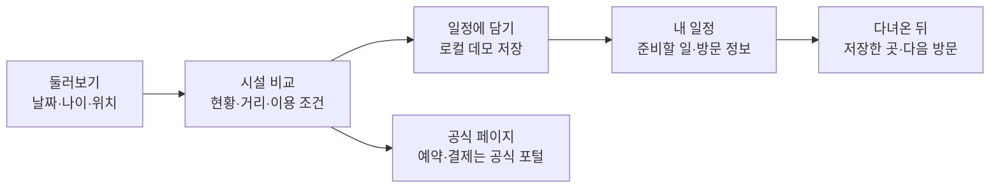

# S-Kids 데모 UI 아키텍처

## 방향

S-Kids는 예약 링크 모음이 아니라 아이와 보낼 다음 하루를 고르는 탐색 서비스다.
예약은 공식 포털에서 완료하지만, S-Kids의 사용자 흐름은 예약 전후까지 이어진다.



## 화면 구조

```text
앱 헤더: S-Kids / 데모 안내
  └─ 메시지: 예약은 시작이에요
  └─ 둘러보기
      ├─ 이용 날짜
      ├─ 아이 나이 · 위치 · 자치구 필터
      ├─ 검색 결과 요약
      └─ 시설 카드
          ├─ 이용 조건 / 거리
          ├─ 회차별 현황
          ├─ 일정에 담기
          └─ 공식 페이지
  └─ 내 일정
      ├─ 담아둔 시설
      └─ 방문 전 준비 체크리스트
  └─ 저장한 곳 / 내 정보
      └─ 데모 범위와 데이터 출처 안내
하단 탭: 둘러보기 · 내 일정 · 저장한 곳 · 내 정보
```

## 계약 경계

- 시설·필터·현황 데이터는 기존 `GET /api/facilities` 계약을 유지한다.
- 새로고침은 기존 `POST /api/facilities/{id}/availability/refresh` 계약을 유지한다.
- 일정에 담기는 동작은 실제 예약/계정 데이터가 아니라 브라우저 `localStorage` 기반 데모 상태다.
- 예약·로그인·결제·예약 확정은 S-Kids가 처리하지 않고 공식 포털로 이동한다.
- 실제 데이터가 연결되기 전까지 모든 현황 숫자와 일정 예시는 데모임을 화면에 명시한다.

## UI 원칙

- 미소 레퍼런스처럼 한 화면에 핵심 행동을 하나만 크게 보여주고, 나머지는 단계적으로 노출한다.
- 주황색은 S-Kids의 선택·저장·주요 행동에만 사용한다. 가능/마감/휴관 등 데이터 상태 색과 섞지 않는다.
- 카드마다 같은 정보량을 강요하지 않고, 시설명·이용 가능성·다음 행동을 먼저 보여준다.
- 모바일 폭 360px부터 사용할 수 있도록 가로 스크롤 필터와 세로형 시설 카드를 사용한다.
- 데모 데이터는 실제 예약처럼 보이지 않도록 배너, 상태 설명, 공식 링크 문구로 경계를 반복해서 알린다.
