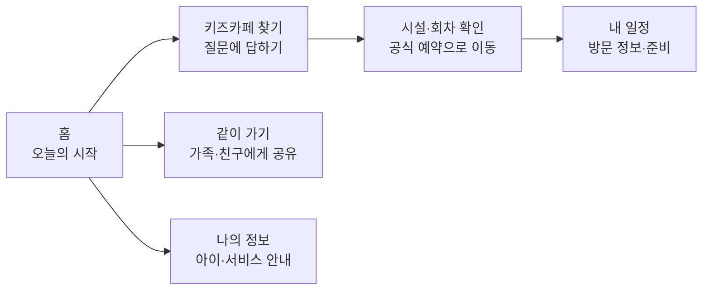

# S-Kids 데모 UI 아키텍처

## 방향

S-Kids는 예약 검색 결과를 나열하는 서비스가 아니라 아이와 보낼 하루를 고르는 생활형 앱이다.
예약은 첫 행동일 뿐이고, 찾기 전의 질문·이용 일정·함께 가기·다녀온 뒤의 다음 선택까지
하나의 앱 구조 안에서 이어진다. 미소 레퍼런스의 실제 콘텐츠 흐름(홈, 예약하기, 예약내역,
친구초대, 나의 정보)을 S-Kids의 도메인에 맞게 번역한다.



## 화면 구조

```text
앱 셸: 주황색 홈 / 흰색 콘텐츠 / 4개 하단 탭
  └─ 홈
      ├─ 큰 서비스 메시지
      ├─ 키즈카페 찾기 CTA
      └─ 예정된 이용 일정 또는 다음 행동
  └─ 키즈카페 찾기
      ├─ 언제 갈까요? → 답변
      ├─ 아이는 몇 살인가요? → 답변
      ├─ 어디에서 찾을까요? → 답변
      ├─ 서울 전체 또는 20개 이상 자치구 목록에서 복수 선택
      └─ 결과 카드 → 시간대·잔여/정원·상태 → 공식 페이지
  └─ 내 일정
      ├─ 예정된 이용 내역
      └─ 방문 전 확인할 정보
  └─ 같이 가기
      └─ 가족·친구에게 현재 장소/서비스 공유
  └─ 나의 정보
      ├─ 아이 정보(데모)
      ├─ 알림/서비스 안내
      └─ 데이터 출처와 공식 포털
하단 탭: 홈 · 내 일정 · 같이 가기 · 나의 정보
```

## 계약 경계

- 시설·필터·현황 데이터는 기존 `GET /api/facilities` 계약을 유지한다.
- 새로고침은 기존 `POST /api/facilities/{id}/availability/refresh` 계약을 유지한다.
- 일정에 담기는 동작은 실제 예약/계정 데이터가 아니라 브라우저 `localStorage` 기반 데모 상태다.
- 예약·로그인·결제·예약 확정은 S-Kids가 처리하지 않고 공식 포털로 이동한다.
- 실제 데이터가 연결되기 전까지 모든 현황 숫자와 일정 예시는 데모임을 화면에 명시한다.

## UI 원칙

- 미소 레퍼런스처럼 한 화면에 핵심 행동을 하나만 크게 보여주고, 질문과 답변을 순서대로 쌓는다.
- 미소처럼 콘텐츠 흐름은 질문과 답변을 순서대로 쌓되, 결과 화면은 예약 판단에 필요한 정보가 먼저 보이는 압축 카드 목록으로 전환한다.
- 지역은 한 곳을 강제로 고르게 하지 않는다. 서울 전체를 기본값으로 두고 20개 이상 자치구를 한 화면에서 복수 선택할 수 있게 한다.
- 결과 카드는 시설명/지역 1줄, 시간대별 잔여·정원과 상태 1줄, 일정 저장·공식 예약 1줄의 2~3줄 밀도를 우선한다. 주소·연령·데이터 안내는 상세 영역으로 낮춘다.
- 폰트는 Pretendard 기반의 짧고 선명한 위계를 사용한다. 시설명보다 시간과 수치가 빠르게 읽히도록 수치에는 고정폭 숫자 정렬을 적용한다.
- 주황색은 홈의 시작과 선택 답변에 사용하고, 가능/마감/휴관은 별도 상태 언어로 구분한다.
- 모바일 360px를 기준으로 상단 앱 헤더·넓은 여백·하단 탭을 고정한다.
- 실제 예약이 아닌 데모 현황은 결과와 공식 링크에서 반복해서 경계를 표시한다.
